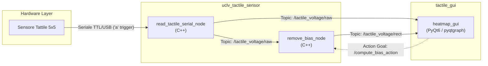

# 🤖 ROS 2 Tactile Sensor Suite (`ros2_ws`)


Complete ROS 2 workspace designed for real-time data acquisition, debiasing, and 2D visualization of matrix tactile sensors ($5 \times 5$ taxels). It includes low-latency C++ serial drivers, custom ROS 2 message/action interfaces, a PyQt6 visual GUI, and a containerized Docker development environment with X11 graphics passthrough.

---

## 📐 System Architecture

The software stack processes data across a dedicated three-tier pipeline:



---

## 📁 Workspace Structure

```text
ros2_ws/
├── docker_scripts/                     # Docker development container environment
│   ├── Dockerfile                      # User, serial (dialout), and GUI dependencies
│   ├── docker_build_image.sh           # Image build script
│   ├── docker_run_container.sh         # Container launcher with X11 & hardware mounting
│   └── docker_connect.sh               # Shell attachment tool
└── src/
    ├── dummy_publisher.py              # Standalone synthetic data generator for testing
    ├── tactile_gui/                    # Real-time 2D visualizer package (Python/PyQt6)
    │   ├── launch/                     # GUI standalone launch files
    │   └── tactile_gui/                # Heatmap rendering engine and ROS 2 node
    └── uclv_tactile_sensor/            # Hardware driver & ROS 2 interfaces repository
        ├── uclv_tactile_driver/        # Low-latency acquisition & debiasing nodes (C++)
        └── uclv_tactile_interfaces/    # Custom Msg (TactileStamped) and Action (ComputeBias)
```

---

## 📦 Packages Summary

| Package | Language | Type | Description |
| :--- | :--- | :--- | :--- |
| **`docker_scripts`** | Bash / Docker | Environment | Containerization setup with USB serial access and X11 forwarding. |
| **`uclv_tactile_driver`** | C++17/20 | Driver / Filter | Reads serial frames, computes matrix voltage ($0.0 - 3.3\text{ V}$), and filters bias offset. |
| **`uclv_tactile_interfaces`** | IDL / CMake | Interfaces | Defines `Tactile.msg`, `TactileStamped.msg`, and `ComputeBias.action`. |
| **`tactile_gui`** | Python 3 | GUI | Real-time heatmap viewer using `pyqtgraph` with instant raw/debiased mode toggling. |

---

## 🚀 Quick Start Guide

### 1. Launch Docker Container (Host Machine)

Ensure the FTDI/USB adapter is connected to the PC before launching:

```bash
cd docker_scripts
./docker_build_image.sh       # Build image (first time only)
./docker_run_container.sh     # Run container with X11 & /dev/ttyUSB0 mounted
```

> [!TIP]
> To open additional terminal sessions inside an already running container, execute:
> ```bash
> ./docker_scripts/docker_connect.sh
> ```

### 2. Build the Workspace (Inside Container)

```bash
cd ~/ros2_ws
colcon build --symlink-install
source install/setup.bash
```

### 3. Launch the Full Pipeline & GUI

Avvia l'acquisizione dal sensore hardware, il filtro di offset e l'interfaccia grafica in un solo comando:

```bash
ros2 launch uclv_tactile_driver tactile_serial_debiased.launch.py serial_port:=/dev/ttyUSB0
```

> [!NOTE]
> If testing without physical hardware, launch the synthetic data generator:
> ```bash
> python3 src/dummy_publisher.py
> ```

---

## 🔧 Hardware Specifications & Voltage Dynamic Range

* **Matrix Dimensions:** $5 \times 5$ taxels ($25$ sensor elements).
* **Sampling Protocol:** Master sends ASCII `'a'`, Microcontroller responds with raw byte array.
* **Raw Voltage Range:** $0.0\text{ V} \le V_{\text{raw}} \le 3.3\text{ V}$ (Resting baseline $\approx 1.2\text{ V} - 2.0\text{ V}$).
* **Debiased Voltage Range:** $-0.2\text{ V} \le V_{\text{rect}} \le 2.0\text{ V}$ (Resting baseline $V_{\text{rect}} \approx 0.0\text{ V}$).

---

## 📜 License

Distributed under the MIT License. See `LICENSE` in individual packages for details.