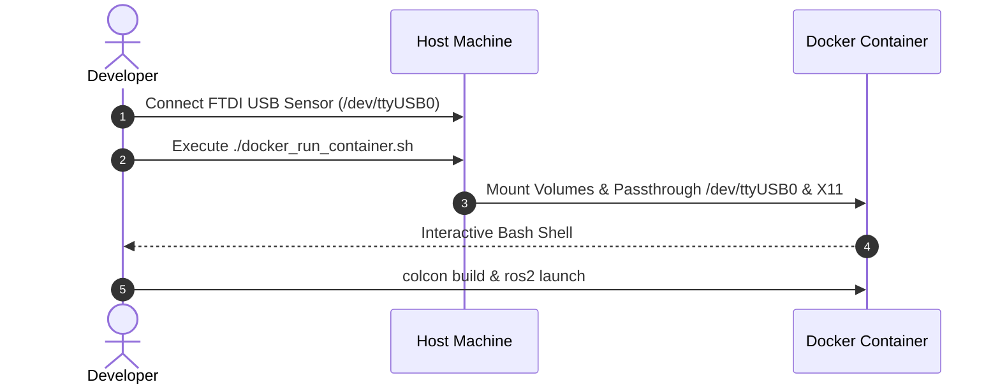

# 🐳 Docker Development Environment (`docker_scripts`)


This directory provides containerization scripts to run the entire ROS 2 Jazzy tactile suite inside an isolated environment. It handles hardware device pass-through (`/dev/ttyUSB0`), low-latency kernel tuning, and X11 graphics display forwarding for PyQt6/PyQtGraph GUIs.

---

## 📋 Features

* **Non-Root User Mapping:** Automatically creates user `user` with matching UID/GID to prevent host file permission corruption.
* **Hardware Passthrough:** Full read/write permissions to `/dev/ttyUSB*` by embedding `dialout`, `tty`, and `plugdev` group privileges.
* **X11 Display Support:** Grants seamless GUI rendering (`rviz2`, `pyqtgraph`) on host monitors via shared X11 sockets.
* **Pre-configured ROS 2 Workspace:** Auto-sources `/opt/ros/jazzy/setup.bash` and `~/ros2_ws/install/setup.bash` on terminal login.

---

## 🛠️ File Structure & Scripts Overview

| File | Description |
| :--- | :--- |
| **`Dockerfile`** | Container blueprint based on Ubuntu 24.04 / ROS 2 Jazzy with system GUI & serial dependencies. |
| **`docker_build_image.sh`** | Compiles the Docker image tagging it for the current host environment. |
| **`docker_run_container.sh`** | Launches a interactive container mounting host volumes, serial devices, and X11 socket. |
| **`docker_connect.sh`** | Connects a new bash session (`exec -it`) to an active container. |

---

## 💡 Usage Workflow



### 1. Build the Docker Image

Run this script once to build the Docker image locally:

```bash
./docker_build_image.sh <IMAGE_NAME>
```
where <IMAGE_NAME> is a name for the image you want to build.

### 2. Run the Container

Launch the interactive container environment:

```bash
./docker_run_container.sh <IMAGE_NAME> <CONTAINER_NAME> <FOLDER_NAME>
```
where <IMAGE_NAME> is the name of the image you have just built, while <CONTAINER_NAME> is a name for the container hosting the image. <FOLDER_NAME> is the name of the local folder you want to mount inside the container ROS2 ws.


> [!IMPORTANT]
> The USB serial adapter **must** be connected to the host PC prior to calling `docker_run_container.sh`, as Docker requires `/dev/ttyUSB0` to exist for device mounting.

### 3. Open Additional Terminals

To open supplementary shells into the running container:

```bash
./docker_connect.sh
```
and select the container you want to connect to.

---

## 🔍 Hardware & Permission Troubleshooting

### Device Permission Check
Run this diagnostic inside the container to verify serial access:

```bash
test -r /dev/ttyUSB0 && test -w /dev/ttyUSB0 && echo "READ/WRITE OK" || echo "PERMISSION DENIED"
```

If permissions are denied on host:
```bash
sudo chmod 666 /dev/ttyUSB0
sudo usermod -aG dialout $USER
```

### X11 GUI Rendering Failure
If PyQt window fails with `Error: Can't open display`:
```bash
# On Host Machine
xhost +local:root
```