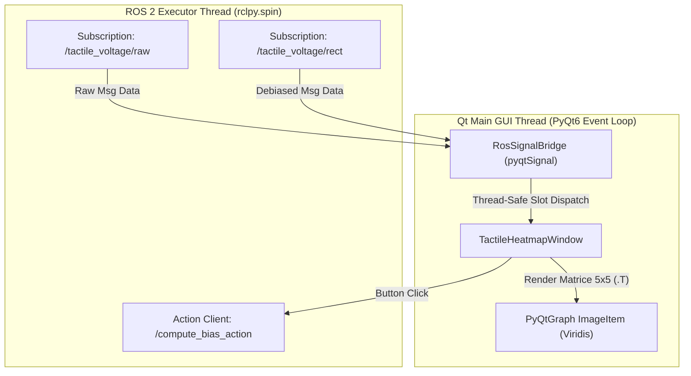

# 📊 Tactile Heatmap GUI (`tactile_gui`)


`tactile_gui` is a high-performance ROS 2 package written in Python/PyQt6. It provides a 2D real-time visual representation ($5 \times 5$ sensor grid) of tactile voltage maps using the `viridis` colormap. It features instant zero-latency view switching between Raw and Debiased signals and provides interactive controls to zero out sensor bias via ROS 2 Actions.

---

## 🛠️ Key Architectural Highlights

* **Permanent Dual Subscription (Zero-Latency Switching):** Subscribes simultaneously to both raw and debiased topics at launch. Switching display mode (`Raw ↔ Debiased`) occurs in $0\text{ ms}$ without resetting ROS subscriptions or causing DDS thread contention.
* **Thread-Safe Architecture:** Uses `pyqtSignal` event bridges to safely pass incoming ROS 2 spin data to the main Qt GUI event loop without data races or GIL bottlenecks.
* **Matrix Spatial Alignment:** Automatically transposes matrix data (`data.T`) to map 1D ROS message arrays into true 2D spatial coordinates $(X, Y)$ without axis swapping.
* **Fixed Dynamic Range Scaling:** Eliminates visual flickering (`autoLevels=False`) by locking range scale limits:
  * **Raw Mode:** $[0.0\text{ V}, 3.3\text{ V}]$
  * **Debiased Mode:** $[-0.2\text{ V}, 2.0\text{ V}]$

---

## 📐 Thread Communication Architecture



---

## ⚙️ ROS 2 Node API

### `tactile_heatmap_gui` (Executable: `heatmap_gui.py`)

#### Subscribed Topics
| Topic Name | Type | Description |
| :--- | :--- | :--- |
| `tactile_voltage/raw` | `uclv_tactile_interfaces/msg/TactileStamped` | Unfiltered sensor voltages ($0.0 - 3.3\text{ V}$). |
| `tactile_voltage/rect` | `uclv_tactile_interfaces/msg/TactileStamped` | Debiased zero-offset voltages. |

#### Action Clients
| Action Name | Type | Description |
| :--- | :--- | :--- |
| `compute_bias_action` | `uclv_tactile_interfaces/action/ComputeBias` | Triggers background bias tare calculation. |

#### Node Parameters
| Parameter | Type | Default | Description |
| :--- | :--- | :--- | :--- |
| `raw_topic` | `string` | `tactile_voltage/raw` | Raw input voltage topic. |
| `debiased_topic` | `string` | `tactile_voltage/rect` | Debiased input voltage topic. |
| `action_name` | `string` | `compute_bias_action` | Bias calculation Action Server name. |
| `rows` | `int` | `5` | Grid row resolution. |
| `cols` | `int` | `5` | Grid column resolution. |

---

## 🚀 Execution & Testing

### Standalone Node Esecution

```bash
ros2 run tactile_gui heatmap_gui.py
```

### Launch File Execution

```bash
ros2 launch tactile_gui tactile_gui.launch.py
```

> [!TIP]
> You can test GUI interactions without hardware by launching `dummy_publisher.py`:
> ```bash
> python3 src/dummy_publisher.py
> ```