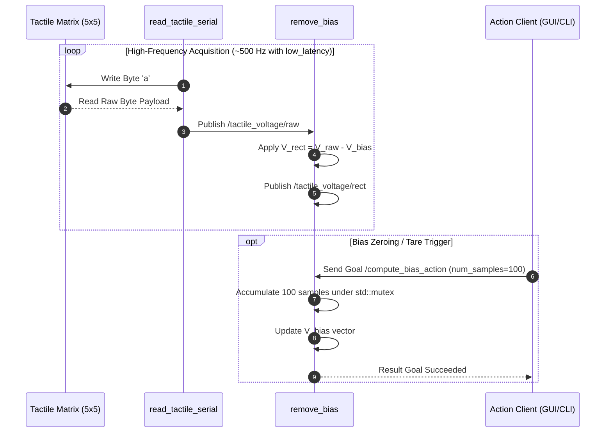

# 🛰️ UCLV Tactile Sensor Stack (`uclv_tactile_sensor`)


`uclv_tactile_sensor` is a high-speed ROS 2 meta-package containing the low-level serial communication drivers (`uclv_tactile_driver`) and custom message/action interface definitions (`uclv_tactile_interfaces`) for matrix pressure sensors ($5 \times 5$ taxels).

---

## 📁 Package Organization

```text
uclv_tactile_sensor/
├── uclv_tactile_driver/          # C++ Nodes for hardware I/O and filtering
│   ├── launch/                   # Hardware acquisition launch files
│   └── src/
│       ├── read_tactile_serial_node.cpp  # Serial port polling reader
│       └── remove_bias_node.cpp          # Thread-safe bias subtraction filter
└── uclv_tactile_interfaces/      # Custom ROS 2 interfaces definition
    ├── action/
    │   └── ComputeBias.action        # Async bias recalculation action
    └── msg/
        ├── Tactile.msg           # Raw float array data
        └── TactileStamped.msg    # Timestamped sensor frame
```

---

## 🔬 Mathematical Formulation & Signal Pipeline

### 1. Raw Voltage Conversion (`read_tactile_serial_node`)
The micro-controller sends 16-bit ADC values over FTDI serial when queried with ASCII `'a'`. The node converts raw samples into voltage:

$$V_{\text{raw}}[i] = \text{ADC}[i] \times \frac{3.3\text{ V}}{2^{N} - 1}$$

### 2. Debiasing & Offset Rectification (`remove_bias_node`)
Sensors exhibit resting offset bias $V_{\text{bias}}[i]$ due to mechanical mounting stress. The debiasing node computes:

$$V_{\text{rect}}[i] = V_{\text{raw}}[i] - V_{\text{bias}}[i]$$

Where the bias vector $V_{\text{bias}}$ is averaged over $M$ samples (default $M=100$) during initialization or upon triggering `ComputeBias.action`:

$$V_{\text{bias}}[i] = \frac{1}{M} \sum_{k=1}^{M} V_{\text{raw}}^{(k)}[i]$$

---

## 🔄 Sequence Diagram & Node Pipeline



---

## ⚙️ ROS 2 Interfaces Specifications

### Custom Messages (`uclv_tactile_interfaces`)

#### `TactileStamped.msg`
```text
std_msgs/Header header
uclv_tactile_interfaces/Tactile tactile
```

#### `Tactile.msg`
```text
float64[] data
```

### Custom Actions (`ComputeBias.action`)
```text
# Goal
int32 num_samples
---
# Result
bool success
---
# Feedback
int32 samples_computed
```

---

## 💻 Driver Node APIs

### 1. `read_tactile_serial`
Reads raw byte frames from `/dev/ttyUSB0` at low-latency mode and publishes raw voltages.

* **Published Topics:**
  * `/tactile_voltage/raw` (`uclv_tactile_interfaces/msg/TactileStamped`)
* **Parameters:**
  * `serial_port` (string, default: `/dev/ttyUSB0`)
  * `baud_rate` (int, default: `1000000`)
  * `rows` (int, default: `5`)
  * `cols` (int, default: `5`)

### 2. `remove_bias`
Thread-safe C++ node (`std::mutex`) subtracting baseline offset from raw voltages.

* **Subscribed Topics:**
  * `/tactile_voltage/raw` (`uclv_tactile_interfaces/msg/TactileStamped`)
* **Published Topics:**
  * `/tactile_voltage/rect` (`uclv_tactile_interfaces/msg/TactileStamped`)
* **Action Servers:**
  * `compute_bias_action` (`uclv_tactile_interfaces/action/ComputeBias`)

---

## 🚀 Launch Files & Testing Commands

### Launch Integrated Pipeline with Hardware

```bash
ros2 launch uclv_tactile_driver tactile_serial_debiased.launch.py serial_port:=/dev/ttyUSB0
```

### Trigger Tare / Bias Recalculation via CLI

```bash
ros2 action send_goal /compute_bias_action uclv_tactile_interfaces/action/ComputeBias "{num_samples: 100}"
```

> [!WARNING]
> **GCC 13 Compatibility Note:** Standard STL headers (`<cstddef>`, `<cstdint>`, `<vector>`) **must** be included before any ROS 2 headers to avoid `size_t is not a member of std` errors when building on Ubuntu 24.04 (ROS 2 Jazzy).